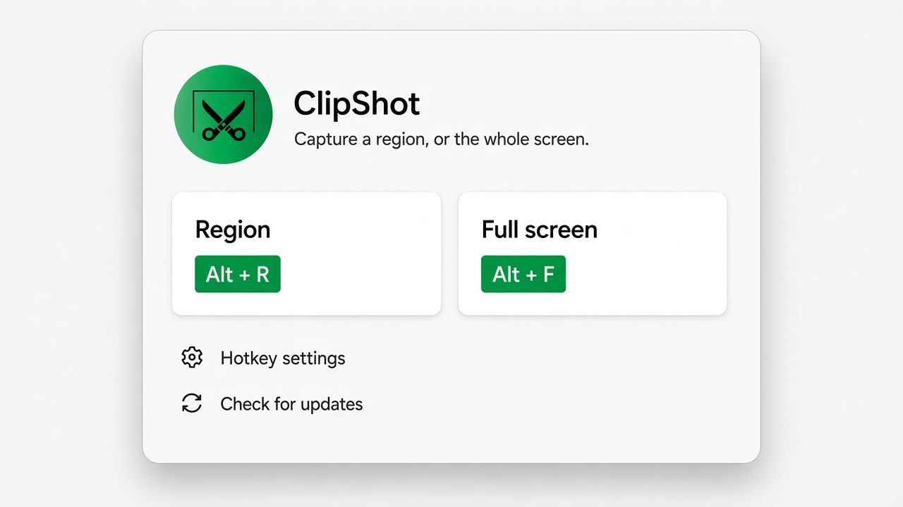

<p align="center">
  
</p>

<p align="center">
  <b>A free, open-source screenshot tool for Windows.</b><br>
  Press a key, drag a region or grab every display, mark it up, then copy it or save a PNG.
</p>

<p align="center">
  <a href="https://github.com/niimbu/clipshot/releases/latest"><b>Download</b></a> ·
  <a href="#install">Install</a> ·
  <a href="#use-it">Use it</a> ·
  <a href="#features">Features</a> ·
  <a href="#shortcuts">Shortcuts</a> ·
  <a href="#development">Development</a>
</p>

<p align="center">
  <a href="https://github.com/niimbu/clipshot/actions/workflows/build.yml"></a>
  <a href="https://github.com/niimbu/clipshot/releases/latest"></a>
  <a href="https://github.com/niimbu/clipshot/releases"></a>
  
  
  <a href="LICENSE"></a>
</p>

<table>
  <tr>
    <td width="33%" valign="top">
      <b>Region or full screen</b><br>
      <kbd>PrtScn</kbd> starts a region on any display. <kbd>Ctrl</kbd>+<kbd>Shift</kbd>+<kbd>1</kbd> captures every display. Both shortcuts can be changed in the main window.
    </td>
    <td width="33%" valign="top">
      <b>Annotate before you share</b><br>
      Pen, highlighter, arrows, shapes, text, and numbered steps. Blur or pixelate a region, then copy with <kbd>Space</kbd> or save a PNG.
    </td>
    <td width="33%" valign="top">
      <b>Screenshots stay on this PC</b><br>
      Nothing is uploaded. ClipShot works offline. It contacts GitHub only when you check for an update or install one.
    </td>
  </tr>
</table>

## See it

<p align="center">
  <br>
  <sub>The editor opens on the capture. <kbd>Space</kbd> copies it and closes. Save writes a PNG.</sub>
</p>

## Install

Windows 10 or 11, 64-bit. Releases are self-contained, so the .NET SDK is only needed if you build from source.

### One-line installer

In PowerShell:

```powershell
irm https://raw.githubusercontent.com/niimbu/clipshot/main/install.ps1 | iex
```

The script downloads the latest `ClipShot.exe` into `%LOCALAPPDATA%\Programs\ClipShot`, clears the download mark on that file, and creates a Start Menu shortcut. If ClipShot is already running, it closes the process first so the file can be replaced. After that, launch ClipShot from the Start Menu or run:

```powershell
& "$env:LOCALAPPDATA\Programs\ClipShot\ClipShot.exe"
```

### Portable

Download **`ClipShot.zip`** or **`ClipShot.exe`** from the [latest release](https://github.com/niimbu/clipshot/releases/latest) and run `ClipShot.exe`. Each release also includes `SHA256SUMS.txt`. A portable copy keeps its settings in `%APPDATA%\ClipShot\settings.json`, the same place as an installed copy.

### If Windows says “Windows protected your PC”

SmartScreen can block the first run of a new or unsigned app.

1. On that screen, click **More info**.
2. Click **Run anyway**.

The PowerShell installer is the usual path. If a file downloaded in a browser still will not start:

```powershell
Unblock-File "$env:USERPROFILE\Downloads\ClipShot.exe"
```

More on distribution and checksums: [docs/DISTRIBUTION.md](docs/DISTRIBUTION.md).

### Updates

The main window has **Check for updates**. When a newer GitHub release exists, a banner and the tray menu offer **View update**. That window lists what changed, without who published it. **Update now** downloads `ClipShot.exe` from this repository, replaces the app, and opens the new version. Shortcuts and the region-dim setting are kept.

## Use it

1. Launch ClipShot. It stays available from the system tray, so the global shortcuts work while the window is closed.
2. Press <kbd>PrtScn</kbd> (region on any display) or <kbd>Ctrl</kbd>+<kbd>Shift</kbd>+<kbd>1</kbd> (every display), or use the buttons on the main window.
3. For a region, drag the area you want. Hold <kbd>Shift</kbd> to keep the selection square. Right-click or press <kbd>Esc</kbd> to cancel. A drag smaller than a few pixels is ignored.
4. The editor opens on top of the capture. Pick a tool and a color, then draw.
5. Press <kbd>Space</kbd> to copy the image to the clipboard and close the editor, or use **Save** to write a PNG. <kbd>Esc</kbd> closes the editor and discards the shot.

The suggested PNG name is `ClipShot-yyyyMMdd-HHmmss.png`. You choose the folder in the save dialog. **Save PNG** on the full-screen card writes every display with no editor.

Closing the main window hides ClipShot to the tray. Shortcuts stay active. The first time this happens, a tray balloon says so. Right-click the tray icon and choose **Exit** to quit. Double-click the icon, or choose **Open ClipShot**, to bring the window back.

**Start ClipShot in the tray when I sign in to Windows** adds a current-user Run entry. It does not install a Windows service.

## Features

- **Region capture.** Drag the area you want. The desktop outside the selection dims. The **Region dim** slider on the main window runs from 0% (outside stays fully visible) to 90%.
- **Full screen.** Captures every connected display, then opens the editor across them.
- **Editor tools.** Pen, highlighter, arrow, line, rectangle, ellipse, text, and numbered steps.
- **Colors.** Red, orange, yellow, green, blue, purple, white, and black.
- **Text.** Click to place a label. <kbd>Enter</kbd> commits it. <kbd>Esc</kbd> cancels that label. <kbd>Space</kbd> does not copy while the text field is focused.
- **Privacy tools.** Blur and pixelate preview on the capture. Select a box afterward to move it or drag its handles.
- **Select.** Move any annotation. Lines and arrows have endpoint grips. Shapes, blur, and pixelate have box handles. <kbd>Delete</kbd> removes the selection, or the last annotation when nothing is selected.
- **Eraser.** Scrub pen strokes, shapes, text, and numbers. It removes only the top mark under the pointer, so a number sitting on pixelation does not delete the pixelation.
- **Undo and redo.** <kbd>Ctrl</kbd>+<kbd>Z</kbd> undoes one mark. <kbd>Ctrl</kbd>+<kbd>Y</kbd> or <kbd>Ctrl</kbd>+<kbd>Shift</kbd>+<kbd>Z</kbd> redoes. Pixelation and a number on top of it stay separate.
- **Straight marks.** Hold <kbd>Shift</kbd> while drawing for straight pen and highlight strokes, axis-aligned lines and arrows, and squares or circles. Hold <kbd>Shift</kbd> while resizing a shape to keep it square.
- **Shortcuts.** Defaults are <kbd>PrtScn</kbd> for a region and <kbd>Ctrl</kbd>+<kbd>Shift</kbd>+<kbd>1</kbd> for the full screen. Click a field, press the new combination, and it saves immediately. **Reset** restores the defaults. If Windows will not register a combination, the status line says so. The main window lists every shortcut, including <kbd>Space</kbd> to copy.
- **Star on GitHub.** The button on the main window opens https://github.com/niimbu/clipshot so you can star the repository.
- **Settings file.** `%APPDATA%\ClipShot\settings.json` stores the two shortcuts and the region-dim value.

## Screenshots

<table>
  <tr>
    <td width="50%"></td>
    <td width="50%"></td>
  </tr>
  <tr>
    <td align="center"><sub>Drag a region. The rest of the desktop dims.</sub></td>
    <td align="center"><sub>Annotate, then copy or save.</sub></td>
  </tr>
  <tr>
    <td colspan="2" align="center">
      <br>
      <sub>Main window: region, full screen, shortcuts, startup, and the region-dim slider.</sub>
    </td>
  </tr>
</table>

## Shortcuts

| Where | Keys | What it does |
|---|---|---|
| Anywhere | <kbd>PrtScn</kbd> | Start a region capture (default) |
| Anywhere | <kbd>Ctrl</kbd>+<kbd>Shift</kbd>+<kbd>1</kbd> | Capture every display (default) |
| Region overlay | drag | Choose the area |
| Region overlay | <kbd>Shift</kbd> while dragging | Keep the selection square |
| Region overlay | right-click or <kbd>Esc</kbd> | Cancel |
| Editor | <kbd>Space</kbd> | Copy and close. Ignored while typing text |
| Editor | <kbd>Esc</kbd> | Close and discard the capture. While typing, cancels that label |
| Editor | <kbd>Enter</kbd> | Commit the text label you are typing |
| Editor | <kbd>Ctrl</kbd>+<kbd>Z</kbd> | Undo |
| Editor | <kbd>Ctrl</kbd>+<kbd>Y</kbd> | Redo |
| Editor | <kbd>Delete</kbd> | Delete the selected annotation, or the last one |
| Editor | <kbd>Shift</kbd> | Straight strokes, axis-aligned lines and arrows, squares and circles |

## Development

Build with the [.NET 10 SDK](https://dotnet.microsoft.com/download) on Windows x64:

```powershell
git clone https://github.com/niimbu/clipshot.git
cd clipshot
dotnet build ClipShot.slnx -c Release
dotnet run --project src/ClipShot.App/ClipShot.App.csproj -c Release
```

The app is WPF. Windows Forms is used for the tray icon and for copying the screen. `assets/branding/build-branding.ps1` turns the SVG mark into `clipshot.ico` and `clipshot-icon.png` with ImageMagick. GitHub Actions runs that script, then publishes a self-contained single-file `win-x64` build. A `v*` tag also uploads `ClipShot.exe`, `ClipShot.zip`, and `SHA256SUMS.txt` to the release.

[Distribution](docs/DISTRIBUTION.md) · [Releasing](docs/RELEASING.md) · [Roadmap](docs/ROADMAP.md)

Issues and pull requests are welcome. For a bug, include your Windows version and the steps to reproduce it.

## Code signing

ClipShot is published by [niimbu](https://github.com/niimbu). Release builds come from this repository's GitHub Actions workflow.

Signing is set up for [SignPath](https://signpath.io/) open-source signing. Until that project is approved and the Actions secrets are in place, tagged releases stay unsigned, and SmartScreen can warn on first launch. A local Authenticode certificate can be used as a fallback. The steps are in [docs/RELEASING.md](docs/RELEASING.md).

### Privacy

ClipShot captures the screen on your computer. Screenshots are copied to the clipboard or saved where you choose. The app collects no usage data and sends no telemetry. It connects to the internet only:

- when you check for updates, to ask GitHub (`api.github.com`) whether a newer release exists
- when you start an update, to download `ClipShot.exe` from this repository's GitHub releases (`github.com`)

## License

[MIT](LICENSE) — © 2026 ClipShot contributors.

<p align="center">
  <a href="https://star-history.com/#niimbu/clipshot&Date"></a>
</p>
