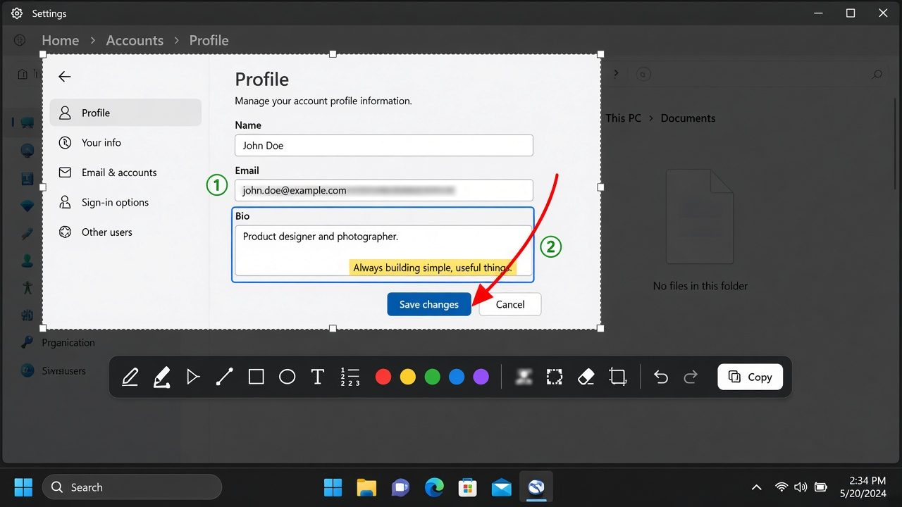
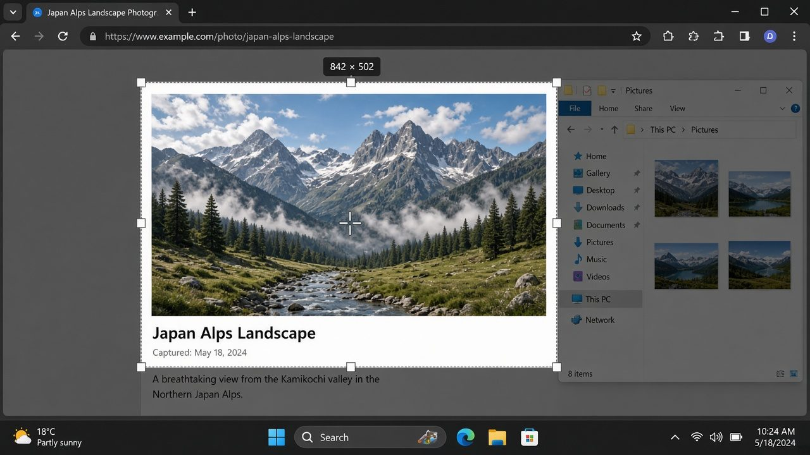
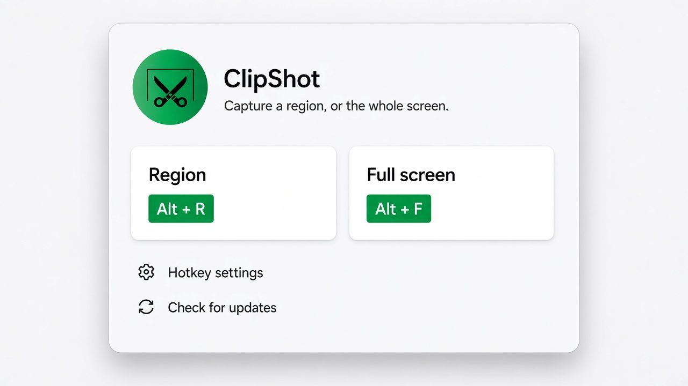

<p align="center">
  
</p>

<h1 align="center">ClipShot</h1>

<p align="center">
  <strong>Fast, free, open-source screenshots for Windows.</strong><br>
  Capture a region or the full screen, annotate in place, then copy or save — without leaving your flow.
</p>

<p align="center">
  <a href="https://github.com/niimbu/clipshot/releases/latest"></a>
  <a href="LICENSE"></a>
  
  
</p>

<p align="center">
  
</p>

## Features

- **Region & full-screen capture** — grab exactly what you need, then annotate before you share
- **In-place annotation** — pen, highlighter, arrows, lines, shapes, text, and numbered steps
- **Privacy tools** — blur or pixelate sensitive areas before copying
- **Select & refine** — move annotations; drag line/arrow endpoints; rescale shapes and effects
- **Copy or save** — send to the clipboard with **Space**, or export a PNG
- **Global hotkeys** — defaults are **Print Screen** (region) and **Ctrl+Shift+1** (full screen); fully customizable
- **Lightweight & portable** — self-contained Windows app; optional Start Menu install

## Screenshots

| Capture a region | Annotate & share |
| --- | --- |
|  |  |

<p align="center">
  
</p>

## Install

### One-line installer (recommended)

In PowerShell:

```powershell
irm https://raw.githubusercontent.com/niimbu/clipshot/main/install.ps1 | iex
```

This downloads the latest release to `%LOCALAPPDATA%\Programs\ClipShot` and adds a Start Menu shortcut.

### Portable

Download **`ClipShot.zip`** or **`ClipShot.exe`** from the [latest release](https://github.com/niimbu/clipshot/releases/latest), then run `ClipShot.exe`. No .NET SDK install required.

## Usage

1. Launch ClipShot (or press your region / full-screen hotkey).
2. Capture a region or the primary display.
3. Annotate with the floating toolbar — arrows, shapes, text, blur, and more.
4. Press **Space** to copy and close, or save a PNG. **Esc** cancels.

Hold **Shift** while drawing for straight lines, axis-aligned arrows, and perfect squares/circles.

## Build from source

Requirements: Windows x64 and the [.NET 10 SDK](https://dotnet.microsoft.com/download).

```powershell
dotnet build ClipShot.slnx -c Release
dotnet run --project src/ClipShot.App/ClipShot.App.csproj -c Release
```

## Contributing

Issues and pull requests are welcome. For bugs, include your Windows version and steps to reproduce.

## License

[MIT](LICENSE) — free for everyone to use, share, and improve.
