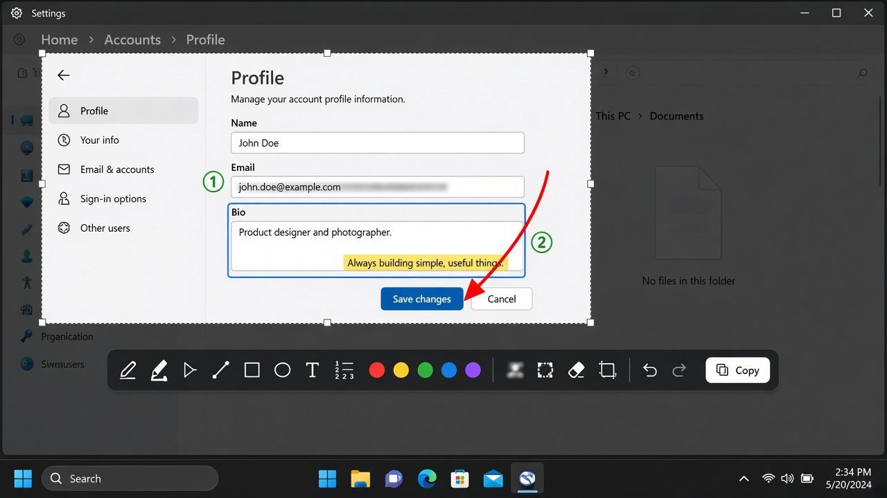
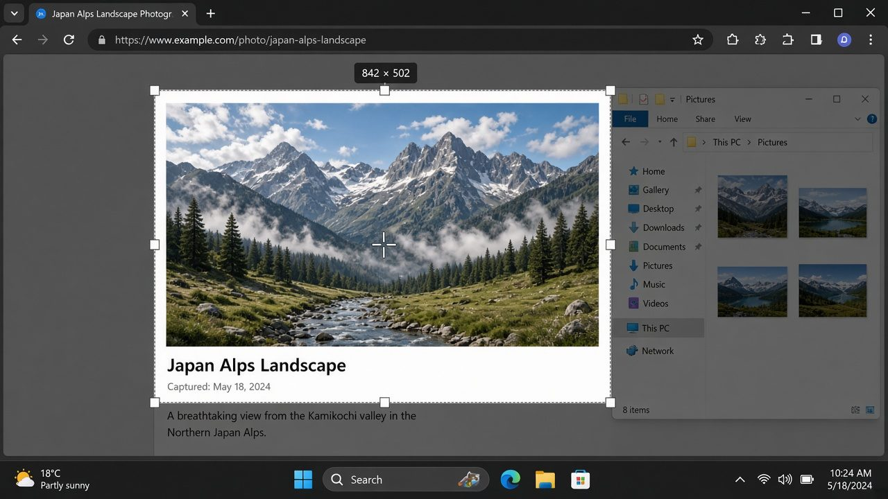

<p align="center">
  
</p>

<p align="center">
  <b>A free, open-source screenshot tool for Windows.</b><br>
  Press a key, drag a region or grab the screen, mark it up, then copy or save — without opening another app first.
</p>

<p align="center">
  <a href="https://github.com/niimbu/clipshot/releases/latest"><b>Download</b></a> ·
  <a href="#install">Install</a> ·
  <a href="#features">Features</a> ·
  <a href="#shortcuts">Shortcuts</a> ·
  <a href="#development">Development</a>
</p>

<p align="center">
  <a href="https://github.com/niimbu/clipshot/actions/workflows/build.yml"></a>
  <a href="https://github.com/niimbu/clipshot/releases/latest"></a>
  <a href="https://github.com/niimbu/clipshot/releases"></a>
  
  
  <a href="LICENSE"></a>
</p>

<table>
  <tr>
    <td width="33%" valign="top">
      <b>Where you already are</b><br>
      Print Screen starts a region capture. The editor opens on the shot, so you annotate before you leave the screen you were looking at.
    </td>
    <td width="33%" valign="top">
      <b>Mark it up, then hide what shouldn't leave</b><br>
      Pen, highlighter, arrows, shapes, text, and numbered steps. Blur or pixelate a password, a name, or a balance before you copy.
    </td>
    <td width="33%" valign="top">
      <b>Stays on your computer</b><br>
      Screenshots are not uploaded. ClipShot works offline and only talks to GitHub when you check for an update.
    </td>
  </tr>
</table>

## See it

<p align="center">
  <br>
  <sub>Capture, annotate, then copy with <kbd>Space</kbd> or save a PNG.</sub>
</p>

## Install

Windows 10 or 11, 64-bit. The release is a self-contained app, so you do not install the .NET SDK.

### One-line installer

In PowerShell:

```powershell
irm https://raw.githubusercontent.com/niimbu/clipshot/main/install.ps1 | iex
```

This downloads the latest `ClipShot.exe` to `%LOCALAPPDATA%\Programs\ClipShot`, clears the download mark, and adds a Start Menu shortcut. If ClipShot is already running, the script closes it first so the file can be replaced.

### Portable

Download **`ClipShot.zip`** or **`ClipShot.exe`** from the [latest release](https://github.com/niimbu/clipshot/releases/latest) and run `ClipShot.exe`. Each release also includes `SHA256SUMS.txt`.

### If Windows says “Windows protected your PC”

ClipShot is a new open-source app. Until a release is Authenticode-signed and has been downloaded enough, SmartScreen may block the first run.

1. On that screen, click **More info**.
2. Click **Run anyway**.

Prefer the PowerShell installer over a browser download. If a downloaded file still will not start:

```powershell
Unblock-File "$env:USERPROFILE\Downloads\ClipShot.exe"
```

Details: [docs/DISTRIBUTION.md](docs/DISTRIBUTION.md).

ClipShot can check GitHub for a newer release from the main window. When one exists, **View update** shows the notes and downloads `ClipShot.exe` from this repository's releases.

## Features

- **Region capture.** Drag the area you want. Everything outside the selection dims; the dim amount is a slider on the main window (0–90%).
- **Full screen.** Grab the primary display, then annotate, copy, or save. A **Save PNG** action on the full-screen card writes the shot without opening the editor.
- **In-place editor.** Pen, highlighter, arrow, line, rectangle, ellipse, text, and numbered steps. Eight colors: red, orange, yellow, green, blue, purple, white, and black.
- **Privacy tools.** Blur or pixelate a region. The effect previews live and can be moved or rescaled.
- **Select and refine.** Move annotations. Drag the endpoints of a line or arrow. Box handles rescale shapes, blur, and pixelate.
- **Eraser.** Scrub pen strokes, shapes, text, and numbers.
- **Undo and redo.** <kbd>Ctrl</kbd>+<kbd>Z</kbd> and <kbd>Ctrl</kbd>+<kbd>Y</kbd> (or <kbd>Ctrl</kbd>+<kbd>Shift</kbd>+<kbd>Z</kbd>).
- **Copy or save.** <kbd>Space</kbd> copies the image and closes the editor. Save writes a PNG. <kbd>Esc</kbd> cancels the capture or closes the editor.
- **Straight lines.** Hold <kbd>Shift</kbd> for straight pen and highlight strokes, axis-aligned lines and arrows, and squares or circles.
- **Global hotkeys.** Defaults are <kbd>PrtScn</kbd> for a region and <kbd>Ctrl</kbd>+<kbd>Shift</kbd>+<kbd>1</kbd> for the full screen. Click a shortcut field and press a new combination; it saves immediately.
- **Tray app.** ClipShot can start in the tray when you sign in to Windows. The tray menu opens the window or exits.
- **Settings stay local.** Shortcuts and the region dim live in `%APPDATA%\ClipShot\settings.json`.

## Screenshots

<table>
  <tr>
    <td width="50%"></td>
    <td width="50%"></td>
  </tr>
  <tr>
    <td align="center"><sub>Drag a region. The rest of the desktop dims.</sub></td>
    <td align="center"><sub>Annotate, then copy or save.</sub></td>
  </tr>
  <tr>
    <td colspan="2" align="center">
      <br>
      <sub>Main window: region, full screen, shortcuts, and the region-dim slider.</sub>
    </td>
  </tr>
</table>

## Shortcuts

| Where | Keys | What it does |
|---|---|---|
| Anywhere | <kbd>PrtScn</kbd> | Start a region capture (default; change it in the app) |
| Anywhere | <kbd>Ctrl</kbd>+<kbd>Shift</kbd>+<kbd>1</kbd> | Capture the primary display (default) |
| Region overlay | drag | Choose the area |
| Region overlay | <kbd>Esc</kbd> | Cancel |
| Editor | <kbd>Space</kbd> | Copy and close (ignored while you are typing text) |
| Editor | <kbd>Esc</kbd> | Close without copying |
| Editor | <kbd>Ctrl</kbd>+<kbd>Z</kbd> | Undo |
| Editor | <kbd>Ctrl</kbd>+<kbd>Y</kbd> | Redo |
| Editor | <kbd>Delete</kbd> | Delete the selected annotation, or the last one |
| Editor | <kbd>Shift</kbd> | Straight strokes, axis-aligned lines and arrows, squares and circles |

## Development

Build with the [.NET 10 SDK](https://dotnet.microsoft.com/download) on Windows x64:

```powershell
git clone https://github.com/niimbu/clipshot.git
cd clipshot
dotnet build ClipShot.slnx -c Release
dotnet run --project src/ClipShot.App/ClipShot.App.csproj -c Release
```

The app is WPF, with Windows Forms used for the tray icon and screen capture. Branding assets are generated by `assets/branding/build-branding.ps1` (ImageMagick). GitHub Actions publishes a self-contained single-file `win-x64` build on version tags.

[Distribution](docs/DISTRIBUTION.md) · [Releasing](docs/RELEASING.md) · [Roadmap](docs/ROADMAP.md)

Issues and pull requests are welcome. For a bug, include your Windows version and the steps to reproduce it. If ClipShot saves you a trip through another screenshot tool, a star helps other people find it.

## Code signing

ClipShot is published by [niimbu](https://github.com/niimbu). Release builds come from this repository's GitHub Actions workflow.

Signing is set up for [SignPath](https://signpath.io/) open-source signing. Until that project is approved and the Actions secrets are in place, tagged releases stay unsigned and SmartScreen can warn on first launch. A local Authenticode certificate can be used as a fallback. The steps are in [docs/RELEASING.md](docs/RELEASING.md).

### Privacy

ClipShot captures the screen on your computer and does not upload screenshots. It collects no usage data and sends no telemetry. It connects to the internet only:

- when you check for updates, to ask GitHub (`api.github.com`) whether a newer release exists
- when you start an update, to download `ClipShot.exe` from this repository's GitHub releases (`github.com`)

“Start ClipShot in the tray when I sign in” writes a current-user Run key. It does not install a service.

## License

[MIT](LICENSE) — © 2026 ClipShot contributors.

<p align="center">
  <a href="https://star-history.com/#niimbu/clipshot&Date"></a>
</p>
